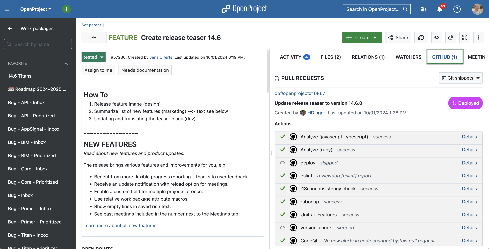

# 🤖 Robotics OpenProject 🤖

**We empower teams to achieve great things together for the good of society.**

OpenProject is a web-based open source project management software for teams and organizations that require transparency, flexibility, and data sovereignty.
Manage projects, portfolios, products, tasks, bugs, agile workflows, roadmaps, and team collaboration in a single platform. OpenProject can be self-hosted and is designed for organizations looking for an open source enterprise-ready alternative to tools such as Jira, MS Project, Monday, Asana, YouTrack while maintaining full control over their data and infrastructure.

OpenProject is trusted by organizations worldwide, including enterprises, public institutions, and highly regulated industries.

**OpenProject's key features include:**

* [Project and portfolio management](https://www.openproject.org/collaboration-software-features/project-portfolio-management/)
* [Agile boards, Kanban, Scrum, SAFe](https://www.openproject.org/collaboration-software-features/agile-project-management/)
* [Project planning and scheduling with Gantt charts](https://www.openproject.org/collaboration-software-features/project-planning-scheduling/)
* [Product and release planning](https://www.openproject.org/collaboration-software-features/product-development/)
* [Task management and team collaboration](https://www.openproject.org/collaboration-software-features/task-management/)
* [Time tracking, cost reporting, and budgeting](https://www.openproject.org/collaboration-software-features/time-tracking/)
* [Bug tracking](https://www.openproject.org/collaboration-software-features/#bug-tracking)
* [Team collaboration, wikis, forums, news](https://www.openproject.org/collaboration-software-features/team-collaboration/)
* [Meeting agendas and meeting minutes](https://www.openproject.org/collaboration-software-features/meeting-management/)
* [Integrations: Nextcloud, XWiki, GitHub, GitLab, and more](https://www.openproject.org/integrations/)

More information can be found on our [website](https://www.openproject.org).

## Start now with OpenProject

- **Free Trial**: [Start a 14-days free trial of OpenProject](https://start.openproject.com/).
- **Community Edition**, free of charge: Download OpenProject and get started with the self-hosted Community edition. If you want to run an instance of OpenProject in production (or for evaluation), refer to our in-depth [installation guides](https://www.openproject.org/download-and-installation/).
- **Enterprise Edition**: Sign up for the Enterprise version, choose between cloud or on-premises and benefit from comprehensive support and Enterprise add-ons.
- **Documentation**: Explore our [comprehensive documentation](https://www.openproject.org/docs/) to help you get up and running quickly.
- **Training**: [Book one of our training or consulting offers](https://www.openproject.org/training-and-consulting/#training-signup) to get your team on board in no time.

## Report bugs

You found a bug? Please [report it](https://www.openproject.org/docs/development/report-a-bug/) to our [OpenProject Community](https://community.openproject.org/projects/openproject). Thank you!

Вы можете запустить проект на любом устройстве под управлением ОС Ubuntu 18 и больше.
Инструкция с командами для монолитного запуска находятся в [данном файле](utils-scripts/run_example.sh).
Данный способ не рекомендуется, ибо запускается на единой машине, зависим от её параметров и создаёт проблемы с отказоустойчивостью.

OpenProject is supported by its Community members, both companies and individuals.

We are always looking for new members to our Community, so if you are interested in improving OpenProject we would be glad to welcome and support you getting into the code. There are guides as well, e.g. a [Quick Start for Developers](https://www.openproject.org/docs/development/development-environment/), but don't hesitate to simply [contact us](https://www.openproject.org/contact) if you have questions.

Краткое описание переменных среды:
- `COMPOSE_PROJECT_NAME` - описывает название проекта Docker Compose, менять нельзя для работы скриптов utils-scripts
- `PUBLIC_HOSTNAME` - публичный домен сервера, на котором разворачивается приложение для корректной работы прокси с SSL
- `PORT` - внутренний порт, который также можно использовать по IP, если прокси не включен
- `DOCKER_BUILDKIT` - BuildKit для ускорения сборки
- `SECRET_KEY_BASE` - ключ, которым будет шифроваться БД
- `DB_PASSWORD` - пароль от БД
- `HTTPS_ENABLE` - включение требование SSL сертификата при подключении (потребуется настроить прокси)
- `GIT_BRANCH` - выбор ветки репозитория, откуда будут грузится исходный код приложения
- `AUTO_UPDATE` - автообновление (при каждом запуске выполняется проверка на обноление и его установка)

Для работы с контейнерами предлагается использовать заготовленный bash скрипты, которые находятся в специальной папке.
Вызывать их нужно из корневого пути репозитория.

#### run.sh

## Stay in contact

Here you can find our [contact information](https://www.openproject.org/contact/). As we regularly update OpenProject, we recommend staying in touch – here is where you can find us:

- [OpenProject Community](https://www.openproject.org/blog/community-instance/) with [forum discussions](https://community.openproject.org/projects/openproject/forums): The open instance where we develop our features – transparent and open for discussions, bug reports or feature requests.
- [LinkedIn](https://www.linkedin.com/company/18706985)
- [Reddit](https://www.reddit.com/r/openproject/)
- [Fosstodon](https://fosstodon.org/@openproject)
- [Bluesky](https://bsky.app/profile/openproject.bsky.social)

#### force_update.sh

We take security very seriously at OpenProject. We value any kind of feedback that
will keep our Community secure. If you happen to come across a security issue we urge
you to disclose it to us privately to allow our users and Community enough time to
upgrade. Security issues will always take precedence over anything else in the pipeline.

For more information on how to disclose a security vulnerability, [please see this page](docs/security-and-privacy/statement-on-security/README.md).

#### remove.sh

Выполняет зачистку контейнеров, образов, томов и кэша сборки.
Тем самым это отчищает вашу машину от данных об приложении. Может пригодиться при неисправностях сборки.

#### save_db.sh

Скрипт сохраняет данные приложения, запущенного в Docker.
В роли метки-тэга сохранения используется текущая дата и время.
Все файлы сохраняются в папке dumps, что позволяет сохранить данные в независимом от виртуальной машины пространстве.

#### restore_db.sh

### OpenProject icon font

Published and created by the OpenProject Foundation (OPF) under [Creative Commons Attribution 3.0 Unported License](http://creativecommons.org/licenses/by/3.0/)
with icons from the following sources
[Minicons Free Vector Icons Pack](http://www.webalys.com/minicons) and
[User Interface Design framework](http://www.webalys.com/design-interface-application-framework.php) both by webalys

## 📖 Остальное описание 📖

Прочее описание и документирование исходного кода выполнено в оригинальном репозитории и не требует более дополнения.

## 📄 Лицензия 📄

Исходный код родительского репозитория приложения и некоторый контент распространяется по открытым лицензиям, что позволяет копировать, адаптировать, изменять, распространять и передавать его с указанием первичного авторства OpenProject Foundation.

Официальная страница проекта: www.openproject.org

Изменения в проекте, опубликованные в данном репозитории распространяются согласно лицензии GNU 3.0
